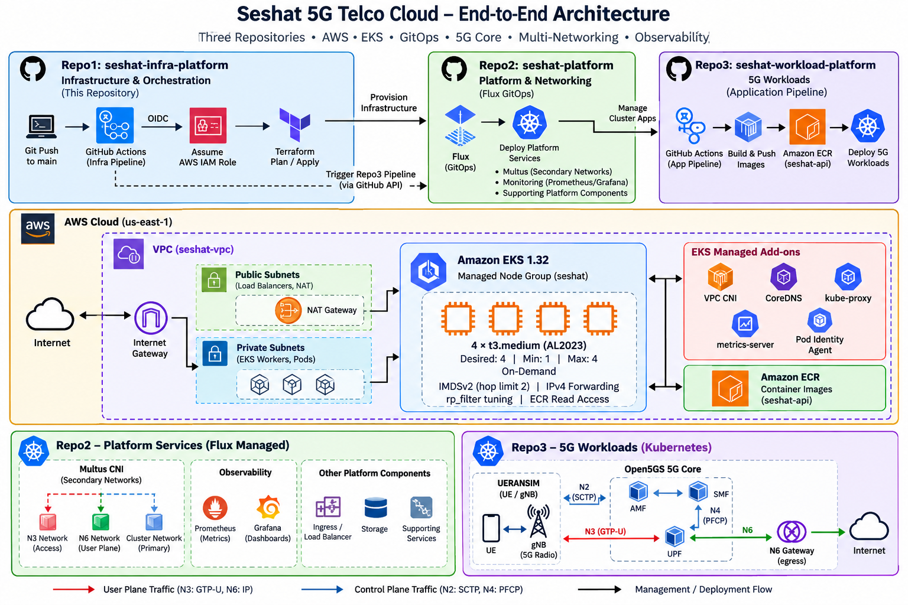

# Seshat 5G Telco Cloud — Infrastructure & Orchestration



This repository is the **infrastructure layer** of a three-repository cloud-native 5G/Telco Cloud lab. It uses Terraform and GitHub Actions to provision and maintain the AWS infrastructure that supports Kubernetes-based telecom workloads.

The environment is built around Amazon EKS and is designed to support cloud-native 5G components, GitOps delivery, secondary Kubernetes networking, monitoring, and automated application deployment.

## Architecture Role

The project is separated into three repositories:

- **Repo1 — Infrastructure & Orchestration (this repository):** AWS, VPC, EKS, IAM, OIDC, ECR, Terraform, and infrastructure CI/CD.
- **Repo2 — Platform & Networking:** Flux-managed platform services including Multus and monitoring.
- **Repo3 — 5G Workloads:** Application and telecom workloads deployed into the EKS cluster.

Repo1 provides the AWS foundation required by the platform and workload repositories.

## Infrastructure

Terraform provisions and manages:

- Amazon VPC networking
- Public and private subnets
- Route tables and Internet/NAT gateway resources
- Amazon EKS 1.32
- EKS managed node group
- Amazon ECR
- IAM roles and policies
- GitHub Actions OIDC authentication
- EKS access entries
- Flux-related Kubernetes resources and credentials

## EKS Compute

The current EKS managed node group is configured with:

- **Kubernetes:** 1.32
- **AMI:** Amazon Linux 2023 x86_64
- **Instance type:** `t3.medium`
- **Desired workers:** 4
- **Minimum workers:** 1
- **Maximum workers:** 4
- **Capacity:** On-Demand

Managed EKS add-ons include:

- Amazon VPC CNI
- CoreDNS
- kube-proxy
- metrics-server
- EKS Pod Identity Agent

## Telco Networking Preparation

The worker nodes include Linux networking configuration required for advanced Kubernetes and telecom networking experiments.

Configured settings include:

```text
net.ipv4.ip_forward = 1
net.ipv4.conf.all.rp_filter = 2
net.ipv4.conf.default.rp_filter = 2
```

The node configuration also includes interface-specific reverse-path filtering configuration and allows the required networking behavior for secondary interfaces and routed telecom traffic.

Instance Metadata Service configuration enforces IMDSv2 and uses a hop limit of `2` to support containerized AWS access patterns where required.

These settings support the networking layer used by the broader project for Multus-based secondary networks and 5G workloads.

## CI/CD and AWS Authentication

A push to `main` starts the GitHub Actions infrastructure pipeline.

```text
Git Push
   |
   v
GitHub Actions
   |
   | OIDC
   v
AWS IAM Role
   |
   v
Terraform Init / Validate
   |
   v
Terraform Plan
   |
   v
Terraform Apply
   |
   v
AWS / EKS Infrastructure
```

GitHub Actions uses **OIDC federation** to assume an AWS IAM role rather than storing long-lived AWS access keys in the workflow.

The workflow currently uses:

```text
Terraform 1.6.2
AWS Region: us-east-1
```

## Application Pipeline Trigger

The infrastructure configuration also contains a Terraform-controlled GitHub workflow dispatch mechanism.

After its Terraform dependency is satisfied, the configuration can invoke the GitHub API to dispatch the Repo3 application workflow:

```text
Repo1 Terraform
      |
      v
Infrastructure / Flux dependency
      |
      v
GitHub API workflow_dispatch
      |
      v
Repo3 app-pipeline.yaml
```

This connects infrastructure orchestration with the workload delivery pipeline while keeping the infrastructure and application repositories separated.

## IAM and Access Design

The repository separates IAM responsibilities into modules for:

- Infrastructure GitHub Actions
- Repo3 / ECR GitHub Actions
- Kubernetes / AWS identity integration
- EKS cluster access
- ECR image access

The EKS cluster uses:

```text
authentication_mode = API_AND_CONFIG_MAP
```

GitHub Actions is granted EKS access through an EKS access entry and associated cluster access policy.

## Repository Structure

```text
.
├── .github
│   └── workflows
│       └── infrastructure-pipeline.yaml
│
├── environments
│   └── dev
│       ├── bootstrap
│       │   └── main.tf
│       │
│       └── platform
│           ├── ci-trigger.tf
│           ├── data.tf
│           ├── main.tf
│           └── outputs.tf
│
├── modules
│   ├── ecr
│   ├── eks
│   ├── flux
│   ├── github-actions
│   ├── github-actions-ecr
│   ├── irsa
│   └── vpc
│
├── architecture.png
└── README.md
```

## Technology Stack

| Area | Technology |
|---|---|
| Cloud | AWS |
| Kubernetes | Amazon EKS 1.32 |
| Infrastructure as Code | Terraform |
| CI/CD | GitHub Actions |
| Authentication | GitHub OIDC / AWS IAM |
| Container Registry | Amazon ECR |
| GitOps Integration | Flux |
| Node OS | Amazon Linux 2023 |
| Networking | AWS VPC + Kubernetes networking |

## Project Context

This infrastructure is the AWS foundation for a larger hands-on Telco Cloud environment that integrates cloud infrastructure, Kubernetes networking, GitOps, observability, and 5G network functions.

The broader environment is designed to exercise both **cloud-native infrastructure engineering** and **telecommunications integration/troubleshooting** rather than treating Kubernetes as an isolated application platform.
